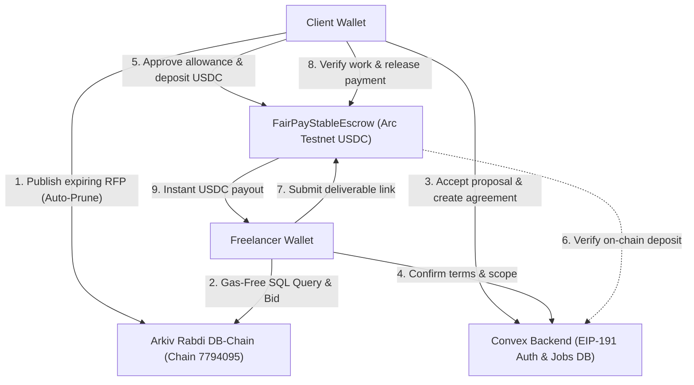
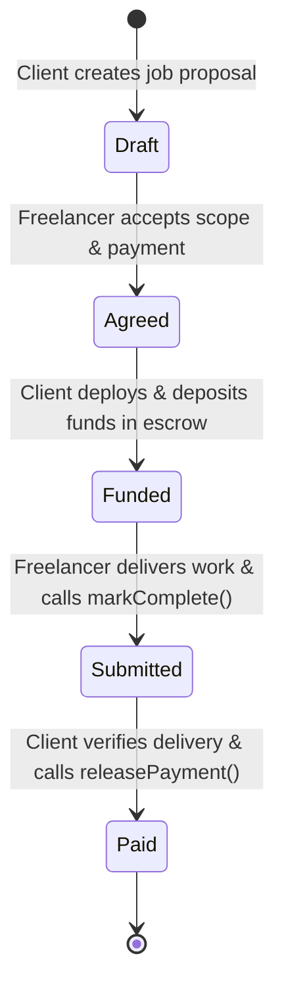

# FairPay 🛡️

**Trustless Web3 Freelance Escrow with Single-Transaction Verification Payouts on Arc Testnet (USDC) & Ethereum Sepolia, Powered by Arkiv DB-Chain for Auto-Expiring Milestone RFPs.**

[](https://nextjs.org/)
[](https://www.typescriptlang.org/)
[](https://rabdi.explorer.arkiv.network)
[](https://arc.io)
[](https://eth-sepolia.blockscout.com)
[](https://soliditylang.org/)
[](https://www.convex.dev/)
[](https://tailwindcss.com/)
[](https://opensource.org/licenses/MIT)

---

## 📌 Executive Summary

Freelancers routinely face late payments, ghosting, and scope disputes, while clients fear paying upfront for incomplete or subpar deliverables. Traditional escrow platforms charge steep 10–20% intermediary fees and impose arbitrary dispute arbitration. Furthermore, open job postings and bidding proposals frequently become stale or abandoned, polluting centralized databases with ghost listings.

**FairPay** combines non-custodial EVM smart contracts with **Arkiv DB-Chain**:

1. **Decentralized RFP & Milestone Coordination**: Clients post milestone RFPs to Arkiv with cryptographic wallet ownership and automated time-based pruning (`ExpirationTime`). Once the bidding window closes, entities natively drop off the query index.
2. **Cryptographic Agreement Fingerprinting**: Parties commit to scope, milestone checkpoints, and atomic payment terms using Keccak-256 agreement hashes.
3. **On-Chain Milestone Escrow**: Clients lock deposits into dedicated smart contracts (`FairPayStableEscrow.sol` for Arc USDC or `FairPayEscrow.sol` for Sepolia ETH).
4. **Single-Transaction Verification Payout**: Client verification releases funds directly to the freelancer in the exact same transaction—eliminating delayed payouts, secondary release friction, and middleman fees.

---

## ⚡ Key Capabilities

- **Arkiv DB-Chain Auto-Expiring RFPs**: Decentralized milestone job listings stored on the Arkiv Rabdi testnet with native cryptographic wallet ownership, gas-free SQL-like querying, and automated time-based pruning.
- **Programmable Stablecoin Escrow (`FairPayStableEscrow.sol`)**: Full ERC-20 / USDC support on Arc Testnet using OpenZeppelin `SafeERC20`, featuring exact deposit allowance approval, balance checks, and idempotent funding.
- **Legacy Native Escrow (`FairPayEscrow.sol`)**: Native ETH milestone escrow on Ethereum Sepolia for single-deposit freelance agreements.
- **Gasless Web3 Authentication**: EIP-191 / SIWE-style cryptographic wallet challenge signing powered by `@convex-dev/auth`. Users sign a secure challenge in their browser wallet costing **$0 in gas**.
- **Role-Based Workspaces**: Context-aware workflows and dashboards for **Clients** and **Freelancers**.
- **Canonical Agreement Fingerprinting**: Keccak-256 hashing of the job ID, chain ID, participant addresses, scope, and amount ensures terms cannot be altered after agreement.
- **Fail-Safe Preflight Protections**: Automatically inspects token contract state (`paused()`, `isBlacklisted()`) prior to deployment to prevent locked capital.
- **Interrupted Recovery & Idempotent Retry**: Browser crashes or rejected wallet confirmations safely resume on the existing contract instance without double charges.
- **Real-Time Synchronized State**: Convex database subscriptions reflect instant status updates across client and freelancer browser tabs.

---

## 🗄️ Arkiv DB-Chain Integration (ETHGlobal Mumbai Track)

FairPay leverages **Arkiv** as an ephemeral, decentralized DB-chain layer for milestone job postings and Request for Proposals (RFPs).

- **Writer wallet**: derived from the server signing key. Confirm the actual owner on each live Arkiv record.
- **Network**: Arkiv Rabdi Testnet (Chain ID: `7794095`)
- **Block Explorer**: [https://rabdi.explorer.arkiv.network](https://rabdi.explorer.arkiv.network)
- **Live User-Facing Route**: Accessible in the FairPay portal navigation under **Arkiv Board** (`/arkiv`)

### Runnable Arkiv SDK Query:

```typescript
import { createPublicClient } from "@arkiv-network/sdk";
import { rabdi } from "@arkiv-network/sdk/chains";
import { http } from "viem";

const client = createPublicClient({
  chain: rabdi({ accessKey: process.env.NEXT_PUBLIC_ARKIV_ACCESS_KEY || "" }),
  transport: http(),
});

// Gas-free query for active milestone listings:
const activeJobs = await client.query(
  "status = str('open') AND category = str('smart-contracts')",
  { limit: 10 }
);
console.log("Active Arkiv Listings:", activeJobs.entities);
```

### Arkiv Track Documentation:

- [`/arkiv/schema.md`](file:///arkiv/schema.md) — Entity definition, indexed fields, and wallet ownership.
- [`/arkiv/why-arkiv.md`](file:///arkiv/why-arkiv.md) — Rationale: what users lose without Arkiv vs. what stays on EVM.
- [`/arkiv/how-you-use-arkiv.md`](file:///arkiv/how-you-use-arkiv.md) — SQL filters, ownership permissions, and user impact.
- [`/arkiv/friction.md`](file:///arkiv/friction.md) — SDK developer feedback and onboarding suggestions.
- [`/arkiv/reach.md`](file:///arkiv/reach.md) — Target audience, traction, and post-hackathon roadmap.
- [`/docs/08-arkiv-integration.md`](file:///docs/08-arkiv-integration.md) — Complete technical architecture, schema specification, and submission evidence.

---

## 🏗️ Architecture & Technical Flow



### Escrow State Machine



---

## 🌐 Supported Networks & Contracts

| Parameter                  | Arc Testnet (Default for Escrow)                          | Arkiv Rabdi Testnet (Coordination DB-Chain)                         | Ethereum Sepolia (Legacy Escrow)                     |
| :------------------------- | :-------------------------------------------------------- | :------------------------------------------------------------------ | :--------------------------------------------------- |
| **Network Name**     | Arc Testnet                                               | Arkiv Rabdi Testnet                                                 | Sepolia Testnet                                      |
| **Chain ID**         | `5042002`                                               | `7794095`                                                         | `11155111`                                         |
| **Primary Role**     | USDC Escrow Financial Settlement                          | Ephemeral RFPs & Bids DB-Chain                                      | ETH Escrow Settlement                                |
| **Payment Asset**    | USDC (ERC-20, 6 decimals)                                 | tGLM (Gasless Public Reads)                                         | ETH (Native, 18 decimals)                            |
| **Token / Contract** | `0x3600000000000000000000000000000000000000`            | Arkiv DB-Chain Primitives                                           | Native Ether                                         |
| **RPC Endpoint**     | `https://rpc.testnet.arc.io`                            | `https://rpc.rabdi.db-chain.testnet.arkiv.network/`               | `https://ethereum-sepolia-rpc.publicnode.com`      |
| **Block Explorer**   | [explorer.testnet.arc.network](https://explorer.testnet.arc.network) | [rabdi.explorer.arkiv.network](https://rabdi.explorer.arkiv.network) | [eth-sepolia.blockscout.com](https://eth-sepolia.blockscout.com) |
| **Blockscout API**   | [Blockscout v2 REST](https://explorer.testnet.arc.network/api/v2) | N/A | [Blockscout v2 REST](https://eth-sepolia.blockscout.com/api/v2) |
| **Faucet**           | [Circle Faucet](https://faucet.circle.com)                 | [Arkiv Faucet / Hub](https://hub.arkiv.network)                      | [Sepolia PoW Faucet](https://sepolia-faucet.pk910.de) |

---

## 🔍 Blockscout Integration (Verification & Explorer Track)

FairPay natively integrates **Blockscout** to deliver transparent, open-source auditability for both clients and freelancers:
- **Direct Explorer Deep-Links**: One-click verification badges on all escrow contracts and transaction hashes for Ethereum Sepolia and Arc Testnet.
- **Real-Time Blockscout API v2**: Integrated [`src/lib/blockscout.ts`](file:///src/lib/blockscout.ts) and [`src/app/api/blockscout/route.ts`](file:///src/app/api/blockscout/route.ts) querying live contract verification, execution status, and gas metrics.
- **In-App Quick Audit Drawer**: Embedded `<BlockscoutInspector />` inside the job detail view allows one-click auditing of contract bytecode matching without leaving the application.
- Full details in [**09-blockscout-integration.md**](file:///docs/09-blockscout-integration.md).

---

### Prerequisites

- **Node.js**: v20.9.0 or higher
- **pnpm** or **npm**
- **Browser Wallet**: MetaMask, Rainbow, Rabby, or Coinbase Wallet with Arc Testnet or Sepolia configured.

### 1. Clone & Install Dependencies

```bash
git clone https://github.com/ritesh-sinha29/FairPay.git
cd FairPay
pnpm install
```

### 2. Configure Environment Variables

Create `.env.local` in your root directory (or copy from `.env.example`):

```bash
cp .env.example .env.local
```

Ensure your `.env.local` contains:

```env
# Convex Deployment
CONVEX_DEPLOYMENT=dev:your-deployment-name
NEXT_PUBLIC_CONVEX_URL=https://your-deployment-name.convex.cloud
NEXT_PUBLIC_CONVEX_SITE_URL=https://your-deployment-name.convex.site

# App Origins
SITE_URL=http://localhost:3000
FAIRPAY_SITE_URL=http://localhost:3000

# RPC Endpoints
ARC_RPC_URL=https://rpc.testnet.arc.io
SEPOLIA_RPC_URL=https://ethereum-sepolia-rpc.publicnode.com

# Arkiv DB-Chain Integration
NEXT_PUBLIC_ARKIV_ACCESS_KEY=""
ARKIV_PRIVATE_KEY="<your-testnet-private-key>"
NEXT_PUBLIC_ARKIV_EXPLORER_URL="https://rabdi.explorer.arkiv.network"
NEXT_PUBLIC_ARKIV_CHAIN_ID=7794095
NEXT_PUBLIC_ARKIV_RPC_URL="https://rpc.rabdi.db-chain.testnet.arkiv.network/"
```

### 3. Initialize Convex & Cryptographic Keys

In your terminal, initialize Convex and generate the RSA key pairs for wallet auth:

```bash
# Link or create your Convex project
npx convex dev --configure new

# In a separate terminal, generate JWT_PRIVATE_KEY and JWKS on the Convex server
pnpm run backend:auth
```

### 4. Compile Smart Contracts & Run Local Tests

```bash
# Compile Solidity contracts with solc 0.8.30
pnpm run contracts:compile

# Run stablecoin escrow integration tests
pnpm run test:stablecoin

# Optional: Run live Arc RPC check
pnpm run check:arc
```

### 5. Launch Development Server

```bash
pnpm run dev
```

Open [http://localhost:3000](http://localhost:3000) in your browser.

---

## 📖 End-to-End User Walkthrough

To test the complete workflow locally, use **two browser profiles** (or an Incognito window) with separate wallets:

1. **Arkiv RFP Discovery**:
   - Navigate to `/arkiv`.
   - Explore live milestone listings queryable via SQL-like filters.
   - Click **Post to Arkiv** to create an auto-expiring RFP with custom expiration (e.g. 7 Days).
2. **Freelancer Onboarding**:
   - Navigate to `/sign-up/freelancer`.
   - Enter your name and headline.
   - Connect your wallet and sign the gasless challenge message ($0 in gas).
3. **Client Onboarding**:
   - In profile 2, navigate to `/sign-up/client`.
   - Connect a distinct wallet and sign the challenge.
4. **Draft & Agreement**:
   - As the client, click **New Escrow Job** (`/jobs/new`).
   - Fill in the title, deliverable description, select the registered freelancer, and enter the USDC budget.
   - Click **Save Proposal**.
   - As the freelancer, open the job and click **Agree to Deal**.
5. **Funding Escrow**:
   - As the client, click **Fund Escrow**.
   - Your wallet prompts two actions:
     1. `approve`: Grants exact USDC allowance to the escrow contract.
     2. `deploy / deposit`: Locks the USDC deposit into the smart contract.
   - The Convex verifier checks deployment bytecode and transaction receipts on-chain; status turns to **Funded**.
6. **Work Delivery**:
   - As the freelancer, add your delivery link (e.g., GitHub PR, Figma link) and submission note.
   - Click **Submit Work for Review** and approve the on-chain `markComplete()` transaction.
   - Status updates to **In review**.
7. **Verification & Payout**:
   - As the client, review the submitted deliverable.
   - Click **Verify Work & Release Payment**.
   - Confirm the transaction in your wallet. The contract automatically pays the full USDC deposit directly to the freelancer's wallet address.
   - Status turns to **Paid**.

---

## 🧪 Test Suite & Verification

FairPay includes unit, integration, and RPC test suites:

```bash
# Type check all TypeScript source files
pnpm run typecheck

# Compile contracts with OpenZeppelin SafeERC20
pnpm run contracts:compile

# Execute automated stablecoin escrow tests
pnpm run test:stablecoin

# Verify live Arc Testnet connection and token contract
pnpm run check:arc

# Build production bundle
pnpm run build
```

### Tested Scenarios:

- [X] Exact USDC allowance and single-transaction verification payout.
- [X] Interrupted token allowance resumption on identical contract address.
- [X] Funding preflight rejection for paused tokens or blacklisted addresses.
- [X] Rollback of failed or partial deposits.
- [X] Rejection of tampering with canonical agreement hashes.
- [X] Preservation of contract state and deposit if freelancer receiver reverts.
- [X] Gasless typed queries against Arkiv Rabdi testnet.

---

## 📂 Project Directory Structure

```text
├── arkiv/                          # Arkiv ETHGlobal Mumbai judging submission files
│   ├── friction.md                 # Developer friction and SDK feedback report
│   ├── how-you-use-arkiv.md        # Filter criteria, ownership rules, and user impact
│   ├── reach.md                    # Target audience, reach, and roadmap
│   ├── schema.md                   # Entity definitions, indexed fields, and expiration
│   └── why-arkiv.md                # Architectural rationale: Arkiv vs. Postgres
├── contracts/
│   ├── FairPayEscrow.sol           # Native ETH escrow contract
│   └── FairPayStableEscrow.sol     # ERC-20 / USDC stablecoin escrow contract
├── convex/
│   ├── auth.config.ts              # Convex Auth provider configuration
│   ├── auth.ts                     # Wallet credentials authorization logic
│   ├── escrow.ts                   # On-chain state verifier & synchronization
│   ├── jobs.ts                     # Job mutations, agreements, and queries
│   ├── schema.ts                   # Data models (jobs, escrows, users, wallets)
│   └── walletActions.ts            # EIP-191 challenge generation & verification
├── docs/                           # Specifications, TRD, PRD, and hackathon roadmap
│   ├── 01-start-here.md            # Operator walkthrough and user journey
│   ├── 02-prd.md                   # Product requirements document
│   ├── 03-trd.md                   # Technical requirements document
│   ├── 04-roadmap.md               # Delivery roadmap and feature progression
│   ├── 05-pitch.md                 # Hackathon presentation and pitch deck notes
│   ├── 06-glossary.md              # Web3 domain terminology and definitions
│   ├── 07-arc-integration.md       # Arc Studio integration and USDC escrow evidence
│   ├── 08-arkiv-integration.md     # Arkiv DB-Chain integration, schema, and evidence
│   └── 09-blockscout-integration.md # Blockscout verification and explorer integration
├── scripts/
│   ├── check-arc.mjs               # Live Arc Testnet RPC diagnostic tool
│   ├── compile-contract.mjs        # solc compiler pipeline & bytecode exporter
│   ├── configure-convex-auth.mjs   # RSA key generation for Convex deployment
│   └── deploy-contract.mjs         # CLI deployment utility for escrow contracts
├── src/
│   ├── app/
│   │   ├── arkiv/                  # Arkiv DB-Chain Escrow Board page
│   │   ├── jobs/                   # Escrow job listings, creation, and detail views
│   │   ├── payments/               # Payment history and CSV export
│   │   ├── privacy/                # Privacy notice page
│   │   ├── terms/                  # Protocol terms of service page
│   │   ├── web/                    # Dedicated public landing page & features showcase
│   │   └── (auth)/                 # Web3 gasless sign-in and sign-up flows
│   ├── components/                 # UI components, modals, and app shell
│   ├── modules/web/                # Public landing page components (Hero, WhyFairPay, FAQ, Navbar, Footer)
│   └── lib/                        # Arkiv SDK helpers, Web3 provider, and contracts
└── tests/
    ├── escrow.test.mjs             # Ganache tests for native ETH escrow
    └── stable-escrow.test.mjs      # Ganache tests for USDC stablecoin escrow
```

---

## 📜 Complete Documentation

Comprehensive engineering, product, and hackathon documentation is available in [`docs/`](<file:///docs/>):

- [**01-start-here.md**](<file:///docs/01-start-here.md>) — Comprehensive operator walkthrough.
- [**02-prd.md**](<file:///docs/02-prd.md>) — Product requirements and experience principles.
- [**03-trd.md**](<file:///docs/03-trd.md>) — Technical requirements and contract specifications.
- [**04-roadmap.md**](<file:///docs/04-roadmap.md>) — Feature progression and validation roadmap.
- [**05-pitch.md**](<file:///docs/05-pitch.md>) — Hackathon narrative, market metrics, and competitive advantages.
- [**06-glossary.md**](<file:///docs/06-glossary.md>) — Web3 domain terminology and definitions.
- [**07-arc-integration.md**](<file:///docs/07-arc-integration.md>) — Arc Studio integration and prize submission evidence.
- [**08-arkiv-integration.md**](<file:///docs/08-arkiv-integration.md>) — Arkiv DB-Chain integration, schema, native expiration, and hackathon judging evidence.
- [**09-blockscout-integration.md**](<file:///docs/09-blockscout-integration.md>) — Blockscout API v2 integration, live escrow contract verification, and explorer deep-linking.

---

## ⚖️ License

Distributed under the MIT License. See `LICENSE` for more information.
