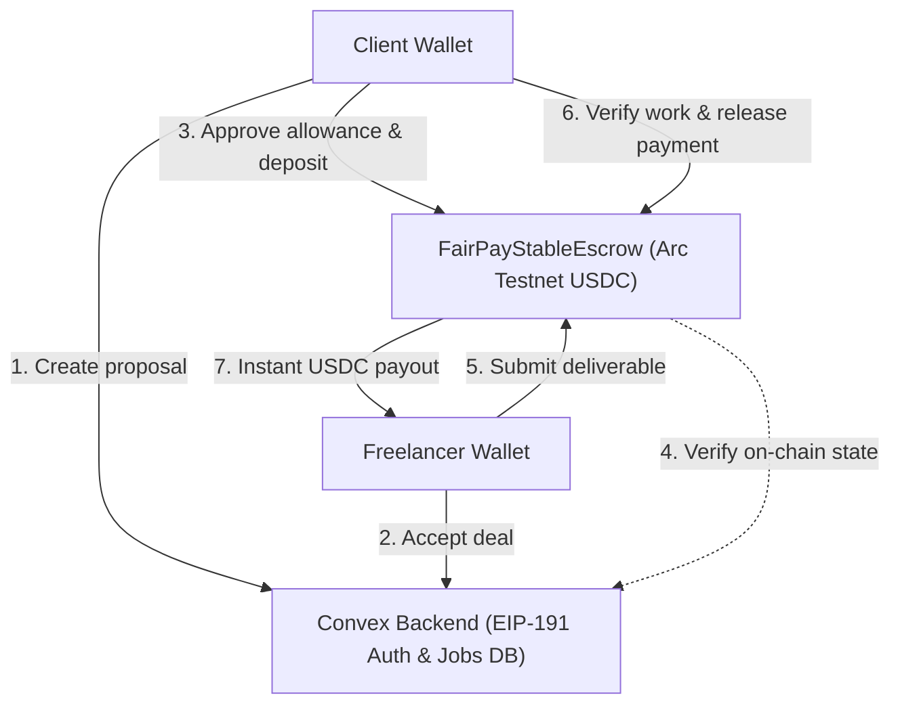
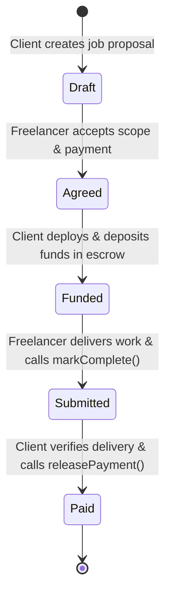

# FairPay 🛡️

**Trustless Web3 Freelance Escrow with Single-Transaction Verification Payouts on Arc Testnet (USDC) & Ethereum Sepolia.**

[](https://nextjs.org/)
[](https://www.typescriptlang.org/)
[](https://soliditylang.org/)
[](https://www.convex.dev/)
[](https://arc.io)
[](https://tailwindcss.com/)
[](https://github.com/ritesh-sinha29/FairPay)

---

## 📌 Executive Summary

Freelancers routinely face late payments, ghosting, and scope disputes, while clients fear paying upfront for incomplete or subpar deliverables. Traditional escrow platforms charge steep 10–20% intermediary fees and impose arbitrary dispute arbitration.

**FairPay** replaces middleman fee structures with non-custodial smart contracts and cryptographic agreement verification:
1. **Both parties agree** on the scope, deadline, and payment terms off-chain.
2. The client locks the deposit into a dedicated on-chain escrow smart contract.
3. The freelancer verifies on-chain funding and delivers the work.
4. **Client verification triggers payment in the same transaction** — no delayed payouts, no secondary release hurdles, and zero intermediary fees.

---

## ⚡ Key Capabilities

- **Programmable Stablecoin Escrow (`FairPayStableEscrow.sol`)**: Full ERC-20 / USDC support on Arc Testnet using OpenZeppelin `SafeERC20`, featuring exact deposit allowance approval, balance checks, and idempotent funding.
- **Legacy Native Escrow (`FairPayEscrow.sol`)**: Native ETH milestone escrow on Ethereum Sepolia for single-deposit freelance agreements.
- **Gasless Web3 Authentication**: EIP-191 / SIWE-style cryptographic wallet challenge signing powered by `@convex-dev/auth`. Users sign a secure challenge in their browser wallet costing **$0 in gas**.
- **Role-Based Workspaces**: Separate signup flows and dashboard contexts for **Clients** and **Freelancers**.
- **Canonical Agreement Fingerprinting**: Keccak-256 hashing of the job ID, chain ID, participant addresses, scope, and amount ensures terms cannot be altered after agreement.
- **Fail-Safe Preflight Protections**: Automatically inspects token contract state (`paused()`, `isBlacklisted()`) prior to deployment to prevent locked capital.
- **Interrupted Recovery & Idempotent Retry**: Browser crashes or rejected wallet confirmations safely resume on the existing contract instance without double charges.
- **Real-Time Synchronized State**: Convex database subscriptions reflect instant status updates across client and freelancer browser tabs.

---

## 🏗️ Architecture & Technical Flow



### Escrow State Machine



---

## 🌐 Supported Networks & Contracts

| Parameter | Arc Testnet (Default for new jobs) | Ethereum Sepolia (Legacy support) |
| :--- | :--- | :--- |
| **Network Name** | Arc Testnet | Sepolia Testnet |
| **Chain ID** | `5042002` | `11155111` |
| **Payment Asset** | USDC (ERC-20, 6 decimals) | ETH (Native, 18 decimals) |
| **Token Address** | `0x3600000000000000000000000000000000000000` | N/A (Native Ether) |
| **RPC Endpoint** | `https://rpc.testnet.arc.io` | `https://ethereum-sepolia-rpc.publicnode.com` |
| **Block Explorer**| [explorer.testnet.arc.io](https://explorer.testnet.arc.io) | [sepolia.etherscan.io](https://sepolia.etherscan.io) |
| **Faucet** | [Circle Faucet](https://faucet.circle.com) | [Sepolia PoW Faucet](https://sepolia-faucet.pk910.de) |

> [!NOTE]
> Arc Studio integration checksum matches the verified source checksum: `170c04ef6758a7f299e7e1b5b312c1fb08aebf39e7114beb94aacab9f025598d` with pinned OpenZeppelin contracts and deterministic compiler outputs.

---

## 🚀 Quick Start Guide

### Prerequisites
- **Node.js**: v20.9.0 or higher
- **npm** / **pnpm**
- **Browser Wallet**: MetaMask, Rainbow, Rabby, or Coinbase Wallet with Arc Testnet or Sepolia testnet configured.

### 1. Clone & Install Dependencies

```bash
git clone https://github.com/ritesh-sinha29/FairPay.git
cd FairPay
npm install
```

### 2. Configure Environment Variables

Create `.env.local` in your root directory (or copy from `.env.example`):

```bash
cp .env.example .env.local
```

Ensure your `.env.local` contains:

```env
CONVEX_DEPLOYMENT=dev:your-deployment-name
NEXT_PUBLIC_CONVEX_URL=https://your-deployment-name.convex.cloud
NEXT_PUBLIC_CONVEX_SITE_URL=https://your-deployment-name.convex.site

SITE_URL=http://localhost:3000
FAIRPAY_SITE_URL=http://localhost:3000

ARC_RPC_URL=https://rpc.testnet.arc.io
SEPOLIA_RPC_URL=https://ethereum-sepolia-rpc.publicnode.com
```

### 3. Initialize Convex & Cryptographic Keys

In your terminal, initialize Convex and generate the RSA key pairs for wallet auth:

```bash
# Link or create your Convex project
npx convex dev --configure new

# In a separate terminal, generate JWT_PRIVATE_KEY and JWKS on the Convex server
npm run backend:auth
```

### 4. Compile Smart Contracts & Run Local Tests

```bash
# Compile Solidity contracts with solc 0.8.30
npm run contracts:compile

# Run stablecoin escrow integration tests
npm run test:stablecoin

# Optional: Run live Arc RPC check
npm run check:arc
```

### 5. Launch Development Server

```bash
npm run dev
```

Open [http://localhost:3000](http://localhost:3000) in your browser.

---

## 📖 End-to-End User Walkthrough

To test the complete workflow locally, use **two browser profiles** (or an Incognito window) with separate wallets:

1. **Freelancer Onboarding**:
   - Navigate to `/sign-up/freelancer`.
   - Enter your name and headline.
   - Connect your wallet and sign the gasless challenge message.
2. **Client Onboarding**:
   - In profile 2, navigate to `/sign-up/client`.
   - Connect a distinct wallet and sign the challenge.
3. **Draft & Agreement**:
   - As the client, click **New Escrow Job** (`/jobs/new`).
   - Fill in the title, deliverable description, select the registered freelancer, and enter the USDC budget.
   - Click **Save Proposal**.
   - As the freelancer, open the job and click **Agree to Deal**.
4. **Funding Escrow**:
   - As the client, click **Fund Escrow**.
   - Your wallet prompts two actions:
     1. `approve`: Grants exact USDC allowance to the escrow contract.
     2. `deploy / deposit`: Locks the USDC deposit into the smart contract.
   - The Convex verifier checks deployment bytecode and transaction receipts on-chain; status turns to **Funded**.
5. **Work Delivery**:
   - As the freelancer, add your delivery link (e.g., GitHub PR, Figma link) and submission note.
   - Click **Submit Work for Review** and approve the on-chain `markComplete()` transaction.
   - Status updates to **In review**.
6. **Verification & Payout**:
   - As the client, review the submitted deliverable.
   - Click **Verify Work & Release Payment**.
   - Confirm the transaction in your wallet. The contract automatically pays the full USDC deposit directly to the freelancer's wallet address.
   - Status turns to **Paid**.

---

## 🧪 Test Suite & Verification

FairPay includes unit, integration, and RPC test suites running on in-memory and live testnets:

```bash
# Type check all TypeScript source files
npm run typecheck

# Execute 7 automated stablecoin escrow test scenarios
npm run test:stablecoin

# Verify live Arc Testnet connection and token contract
npm run check:arc

# Build production bundle
npm run build
```

### Tested Scenarios:
- [x] Exact USDC allowance and single-transaction verification payout.
- [x] Interrupted token allowance resumption on identical contract address.
- [x] Funding preflight rejection for paused tokens or blacklisted addresses.
- [x] Rollback of failed or partial deposits.
- [x] Rejection of tampering with canonical agreement hashes.
- [x] Preservation of contract state and deposit if freelancer receiver reverts.

---

## 📂 Project Directory Structure

```text
├── contracts/
│   ├── FairPayEscrow.sol           # Native ETH escrow contract
│   └── FairPayStableEscrow.sol     # ERC-20 / USDC stablecoin escrow contract
├── convex/
│   ├── auth.config.ts              # Convex Auth provider configuration
│   ├── auth.ts                     # Wallet credentials authorization logic
│   ├── escrow.ts                   # On-chain state verifier & synchronization
│   ├── jobs.ts                     # Job mutations, agreements, and queries
│   ├── schema.ts                   # Data models (jobs, escrows, users, wallets)
│   └── walletActions.ts            # EIP-191 challenge generation & verification
├── docs/                           # Specifications, TRD, PRD, and hackathon roadmap
├── scripts/
│   ├── check-arc.mjs               # Live Arc Testnet RPC diagnostic tool
│   ├── compile-contract.mjs        # solc compiler pipeline & bytecode exporter
│   └── configure-convex-auth.mjs   # RSA key generation for Convex deployment
├── src/
│   ├── app/                        # Next.js App Router (dashboard, jobs, auth)
│   ├── components/                 # UI components, modals, and app shell
│   └── lib/                        # Web3 provider, agreement hashing, and contracts
└── tests/
    ├── escrow.test.mjs             # Ganache tests for native ETH escrow
    └── stable-escrow.test.mjs      # Ganache tests for USDC stablecoin escrow
```

---

## 📜 Complete Documentation

Comprehensive engineering, product, and hackathon documentation is available in [`docs/`](file:///e:/Users/Ritesh%20Sinha/Documents/ChatGPT/ethglobal/docs/):
- [**01-start-here.md**](file:///e:/Users/Ritesh%20Sinha/Documents/ChatGPT/ethglobal/docs/01-start-here.md) — Comprehensive operator walkthrough.
- [**02-prd.md**](file:///e:/Users/Ritesh%20Sinha/Documents/ChatGPT/ethglobal/docs/02-prd.md) — Product requirements and experience principles.
- [**03-trd.md**](file:///e:/Users/Ritesh%20Sinha/Documents/ChatGPT/ethglobal/docs/03-trd.md) — Technical requirements and contract specifications.
- [**04-roadmap.md**](file:///e:/Users/Ritesh%20Sinha/Documents/ChatGPT/ethglobal/docs/04-roadmap.md) — Feature progression and validation roadmap.
- [**05-pitch.md**](file:///e:/Users/Ritesh%20Sinha/Documents/ChatGPT/ethglobal/docs/05-pitch.md) — 3-minute hackathon pitch script and slide structure.
- [**08-arc-integration.md**](file:///e:/Users/Ritesh%20Sinha/Documents/ChatGPT/ethglobal/docs/08-arc-integration.md) — Arc Studio integration and prize submission evidence.

---

## ⚖️ License

Distributed under the MIT License. See `LICENSE` for more information.
