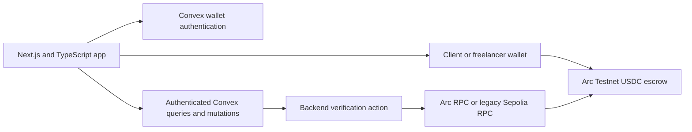
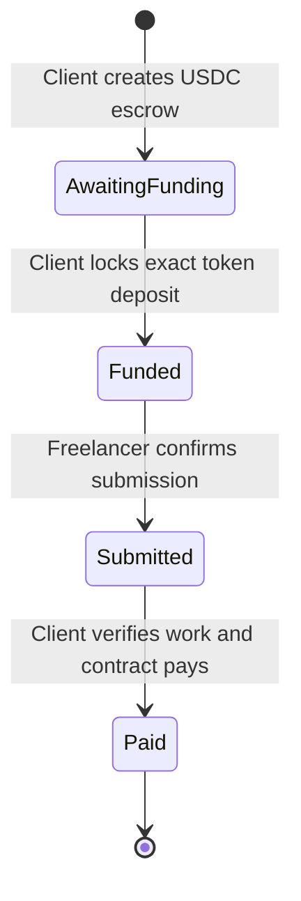

# FairPay technical requirements

Architecture, authentication, data ownership, escrow behavior, and verification.

Working draft · 5 November 2026

## Architecture

Next.js App Router renders the application. Client Components handle wallet prompts and interactive state. Convex provides account sessions, persistent records, realtime subscriptions, role checks, and Node actions for external blockchain verification. The wallet signs and broadcasts transactions. Solidity holds the deposit and enforces the onchain rules.

## Stack

| Layer | Technology | Responsibility |
| --- | --- | --- |
| App | Next.js and TypeScript | Protected routes, forms, dashboards, and job details |
| Components | shadcn/ui and Radix UI | Responsive sidebar, header breadcrumbs, dialogs, menus, cards, inputs, and selection controls |
| Theme | Wekraft globals.css and Geist | Shared tokens, typography, and dark appearance |
| Backend | Convex | Persistent accounts and jobs, access checks, subscriptions, and verification actions |
| Authentication | Convex Auth with custom wallet credentials | Signed single-use challenges and authenticated sessions |
| Chain integration | ethers v6 | Wallet access, signatures, deployment, transactions, and backend RPC reads |
| Contract | Solidity 0.8.30 | Funded to Submitted to Paid lifecycle |
| Stablecoin safety | OpenZeppelin SafeERC20 and ReentrancyGuard | Exact USDC deposits and payouts with rollback on transfer failure |
| Verification | TypeScript, Ganache, and deployed-backend checks | Build, contract regressions, authentication, and permissions |

## Authentication sequence

1. The browser requests access to a wallet and sends its address and requested flow to the challenge action.
2. The backend creates a random nonce and a five-minute message that includes the configured origin, address, chain ID, purpose, and expiry. Signup also binds the chosen role and name to the stored challenge.
3. The wallet signs that exact message.
4. The authentication provider calls a Node action to recover the signer and compare it with the stored address.
5. An internal mutation checks expiry and consumes the challenge atomically. A replay cannot reuse it.
6. Signup creates an account with its verified wallet and client or freelancer role. Sign-in retrieves the existing account, with no role update.
7. Convex Auth manages the session. Next.js proxy protection redirects unauthenticated page requests, and backend functions enforce authorization independently.

The app needs a configured Convex deployment, JWT signing keys, JWKS, and SITE_URL. Signing keys are stored as Convex environment variables. The setup script sends them over stdin and keeps them out of files and command arguments.

## Data model

| Table | Important fields | Access and invariants |
| --- | --- | --- |
| users | name, role, walletAddress, headline | Public signup choices are client or freelancer. Wallet control is verified. Sign-in preserves the saved role |
| walletChallenges | address, message, flow, role, name, expiresAt | Read and consumption use internal functions. Expired records are periodically removed |
| jobs | clientId, freelancerId, addresses, title, description, amountWei, chainId, status | Only the assigned participants can read the job |
| jobs funding fields | fundingHash, fundingReservation, reservationExpiresAt, contractAddress | Reservations serialize funding attempts. Confirmed contracts are unique across jobs |
| jobs delivery fields | submissionNote and deliverableUrl | Only the assigned freelancer can save delivery for a Funded or Submitted job |
| jobs verification fields | verifiedAt and verifiedBlock | Updated through internal writes after backend chain verification |
| Convex Auth tables | accounts, sessions, refresh tokens, rate limits, and related records | Managed by the authentication library |

The historical amountWei field stores integer atomic units: six decimal places for new Arc USDC jobs and eighteen for legacy Sepolia ETH jobs. Formatting and totals use each job’s network; currencies are never summed together. Convex creation and update timestamps replace the earlier browser-only job metadata.

## Authorization

A client can create a job assigned to a registered freelancer. A freelancer cannot create jobs through the backend API. Only a job's client can reserve funding or clear a failed funding attempt. Either participant can request blockchain status verification. Only the assigned freelancer can save its delivery.

Job queries use participant IDs and indexed ownership checks. The freelancer directory exposes the name, optional headline, and verified wallet needed for assignment to authenticated clients. General job records remain restricted to their participants.

Payment states cannot be set by a browser mutation. The backend writes them only through an internal mutation after verifying the blockchain. The Solidity contract independently checks transaction callers, so bypassing the frontend cannot bypass its roles.

## Job creation and funding

Creating a job stores a Draft proposal with scope, assignment, and amount. The client confirms those terms by sending the proposal. Only the assigned freelancer can accept it, which sets acceptedAt and closes the deal. Acceptance is idempotent. The server rejects new funding reservations before acceptance.

After agreement, funding reserves the job for one request and deploys its contract with the client's wallet. For USDC, creation does not lock the payment. The client grants the exact allowance, then calls fund(); only a confirmed token deposit sets Funded. A created but unfunded escrow stays Draft and is resumed on the same address. A rejected unsigned request releases its reservation. An interrupted unsigned reservation expires after ten minutes. Previously broadcast funding attempts can still be recovered.

Once a transaction is broadcast, its hash is saved before waiting for confirmation. The backend compares its receipt and input against the expected contract bytecode, encoded title, freelancer, sender, and deposit. Arc deployments additionally encode the official USDC address, amount, and a canonical agreement hash committing to the job ID, chain, parties, title, scope, and amount. Only a matching confirmed deployment can attach a contract to the job. The unique contract index prevents one escrow from being attached to two jobs.

Interrupted funding can be recovered with a confirmed deployment hash. Replacement hashes are tracked when available. A reset checks that the recorded transaction has completed without a successful contract deployment before clearing the draft's attempt.

## Delivery and payout

The freelancer saves an HTTPS deliverable link and a note, then signs markComplete. Saving the note can succeed even if signing or broadcasting later fails, so the status remains Funded until the contract transition is verified. The freelancer can retry.

The client reviews the delivery and selects Verify work & release payment. This single action calls verifyAndRelease through the client wallet for Arc USDC, or releasePayment for legacy Sepolia ETH. Client verification and payout share the same transaction, so there is no separately saved Verified state or subsequent payment action. The wallet still requires transaction confirmation. If the transaction fails or is rejected, the job remains Submitted and the deposit stays locked.

The UI waits for a receipt and asks the backend to verify the updated contract state. This backend check confirms blockchain state; the client assesses work quality. Convex subscriptions propagate the verified update to both users. A failed refresh preserves the saved record and transaction information for recovery.

## Contract rules

New USDC contracts store immutable client, freelancer, token, amount, and agreementHash fields, plus title and status. Their enum values are AwaitingFunding 0, Funded 1, Submitted 2, and Paid 3. AwaitingFunding maps to Draft in Convex. Legacy ETH contracts retain Funded 0, Submitted 1, and Paid 2. The UI displays Submitted as In review.

The constructor rejects empty deposits, a zero or self-assigned freelancer address, and titles outside 1 to 160 UTF-8 bytes. Only the freelancer can mark a Funded job complete. Only the client can release a Submitted job.

verifyAndRelease uses OpenZeppelin SafeERC20 and ReentrancyGuard with checks-effects-interactions. It sets Paid before transfer and checks the freelancer receives the exact amount. A failed or short transfer reverts to Submitted and preserves the deposit. A second payout fails the status check. The original releasePayment remains unchanged for legacy jobs. Excess tokens or forced native transfers have no recovery path.

## Synchronization and consistency

Backend actions read status at a selected block and store its height. A late result from an older block cannot overwrite a newer verified record. Requests are idempotent with respect to the same job and contract. User-supplied status values never determine funding or payout state.

An external RPC is still a dependency for verification. Its failure can temporarily leave an older verified status visible. The job screen shows the last verification time and provides a refresh action. Wallet transactions can still exist onchain while the UI is awaiting synchronization.

## Routes and source map

| Route or source | Purpose |
| --- | --- |
| / | Root router: redirects authenticated users to /jobs (once per session) or displays landing page |
| /web | Dedicated public landing page showcasing protocol layers, 0% fee comparison, and interactive FAQ |
| /arkiv | Arkiv DB-Chain decentralized RFP board with live SQL query builder and native TTL auto-pruning |
| /sign-up | Choose client or freelancer signup |
| /sign-up/client and /sign-up/freelancer | Separate role-specific forms and wallet verification |
| /sign-in | Return with the account's wallet |
| /jobs | Account-scoped overview and jobs |
| /jobs/new | Client job form |
| /jobs/[jobId] | Participant-only brief, funding, delivery, and payment |
| /payments and /account | Payment history and account details |
| /terms and /privacy | Protocol terms of service and privacy notice |
| convex/auth.ts and walletActions.ts | Wallet authentication and signature verification |
| convex/jobs.ts | Job queries, mutations, reservations, and protected writes |
| convex/escrow.ts | Deployment, payment-status, and failed-funding verification |
| src/lib/arkiv.ts | Typed Arkiv DB-Chain SDK public and wallet clients |
| src/lib/blockscout.ts | Blockscout API v2 verification and contract bytecode inspector |
| src/modules/web | Public showcase components (Hero, WhyFairPay, FAQ, Navbar, Footer) |
| src/components/ui | Official shadcn component source |
| contracts/FairPayEscrow.sol | Escrow payment rules |
| contracts/FairPayStableEscrow.sol | Studio-generated Arc USDC escrow; locally compiled artifact is used by both the wallet and verifier |

## Verification status

Contract tests pass for the payment flow, authorization, invalid inputs, duplicate payout prevention, and rollback after a rejected transfer. Deployed-backend checks have exercised real signup/sign-in, invalid signatures, replay rejection, role restrictions, private job access, concurrent funding reservations, and persistence across sessions. Browser checks have exercised real wallet-signature signup/sign-in with temporary unfunded QA identities.

A public Arc funding, submission, and payout rehearsal remains pending funded test wallets. Local USDC tests cover exact amounts, allowance failure, retry, role restrictions, failed/short transfer rollback, duplicate payout, and backend agreement verification. Independent contract review, broader adversarial tests, production monitoring, wallet recovery, and sponsor-specific deployment are further work.

The build preserves the original legacy ETH deployment artifact, including compiler metadata, so changing checkout line endings does not invalidate old payment recovery. New contracts must use a versioned artifact. Arc source uses LF line endings and a pinned compiler/library configuration. Funding also checks USDC pause and participant transfer status; later issuer restrictions can still prevent payout.

## References

- [Convex authentication and functions](https://docs.convex.dev/auth/functions-auth)
- [Convex Auth](https://labs.convex.dev/auth)
- [shadcn sidebar](https://ui.shadcn.com/docs/components/sidebar)
- [Next.js Server and Client Components](https://nextjs.org/docs/app/getting-started/server-and-client-components)
- [ethers v6 documentation](https://docs.ethers.org/v6/getting-started/)
