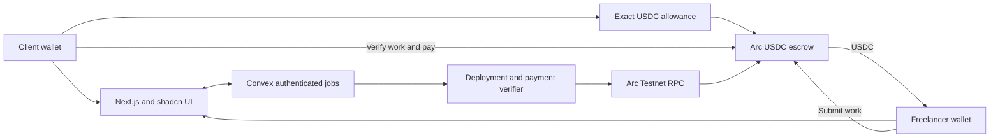

# FairPay Arc integration and submission evidence

Selected direction: USDC escrow on Arc Testnet. This document separates the implemented app from the evidence still needed for submission.

## Product flow

Client sends proposal → assigned freelancer accepts → client creates escrow, permits the exact USDC amount, and locks it → freelancer delivers → client verifies work → the same transaction pays the freelancer.

The token permission during funding is an ERC20 allowance. It is unrelated to reviewing the work. Client work verification has one transaction and no subsequent payment step. There is no release when a timer expires.

## What changed

- New jobs use test USDC on chain 5042002. Existing Sepolia ETH jobs preserve their original amounts and contract.
- A canonical agreement fingerprint commits to the job ID, network, parties, title, scope, and atomic payment amount.
- The backend validates the deployment input against that complete agreement and checks the actual contract state. Creation alone never marks a USDC job Funded.
- Interrupted USDC permission or deposit requests resume on the created escrow. A successful deposit cannot be charged twice.
- Payment summaries and CSV exports retain the currency and network. ETH and USDC totals are separate.

## Architecture



## Arc Studio Integration

FairPay's stablecoin escrow was reviewed and tested within Arc Studio, utilizing the official Arc Testnet USDC contracts.

The contract source in `contracts/FairPayStableEscrow.sol` has been compiled and tested with pinned OpenZeppelin SafeERC20 contracts and comprehensive preflight test cases covering paused tokens, blacklist restrictions, and atomic single-transaction release.

## Sponsor checklist

The [official Arc prize requirements](https://ethglobal.com/events/mumbai/prizes#arc) require Studio as the starting point, USDC/EURC programmable contracts, a shareable project, a working frontend/backend, architecture diagram, repository, and video showing the tools. The advanced-contract examples include disputes and automatic release. Eligibility and the correct existing-project entry category need sponsor confirmation.

| Evidence | Current status |
| --- | --- |
| Arc Studio project | Created; contract and test work completed |
| Studio source matches local source | Verified by source SHA256; artifact rebuilt locally with the pinned toolchain |
| Arc RPC and official token precision | Read-only live check passed |
| Local USDC contract, wallet flow, and verifier tests | Seven passed, including interrupted allowance recovery and transfer-status checks |
| Convex Arc job and agreement permissions | Passed against the development deployment; disposable fixtures removed |
| Backend deployment | Development backend updated |
| Public contract deployment and payment proof | Pending confirmed transaction evidence |
| Two-user app rehearsal | Pending independently controlled funded wallets |
| Public frontend | Pending hosting configuration |
| Judge-accessible Studio project | Pending access check |
| Video and sponsor category | Pending |

## Run the checks

```sh
npm run contracts:compile
npm run test:contract
npm run test:stablecoin
npm run check:arc
npm run build
npm run backend:push
```

Arc payment configuration lives in src/lib/payments.ts. The deployed backend uses ARC_RPC_URL if set, or the official public endpoint otherwise. The ERC20 interface uses six decimals, and native gas uses eighteen. See the [network reference](https://docs.arc.io/arc/references/connect-to-arc) and [token reference](https://docs.arc.io/arc/references/contract-addresses).

For a public rehearsal, use the Circle faucet for both wallets. Fund a small job, save all transaction hashes, and capture client verification paying the freelancer. Record deployment, allowance, deposit, submission, and payout separately. A Studio contract test and an app rehearsal are distinct pieces of evidence.

## Pitch wording

“FairPay locks a freelance job's agreed USDC payment before work begins. When the client verifies the delivered work, the contract pays the freelancer in the same transaction. Both parties can inspect the funded agreement and payment state.”

Use confirmed public transaction links before claiming public settlement has been demonstrated. No refund, arbitration, inactivity release, independent audit, production launch, or prize eligibility is claimed.
