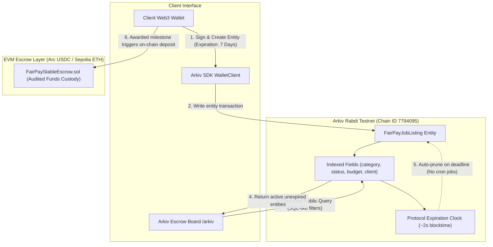

# FairPay Arkiv DB-Chain Integration & Submission Evidence

**ETHGlobal Mumbai Track**: *Build on Arkiv (from scratch) — $4,000 Track ($3,000 1st / $1,000 2nd)*

---

## 1. Executive Summary

In decentralized freelance work, milestone Request for Proposals (RFPs) and task coordination are inherently **ephemeral**:
- Clients initiate project RFPs with fixed bidding windows (e.g. 7 days or 14 days).
- In traditional Web2 platforms (Upwork, Fiverr) or relational databases (PostgreSQL), expired or abandoned listings linger as dead state, requiring brittle background cron jobs or manual garbage collection.
- Storing high-churn, short-lived listings on standard EVM execution chains (like Ethereum or Arbitrum) imposes prohibitive gas fees on clients for simple postings and deletions.

**FairPay leverages Arkiv**—a decentralized, serverless DB-chain network built on Ethereum—as an ephemeral, wallet-owned coordination layer. Client RFPs and milestone specifications live on Arkiv with **cryptographic wallet ownership**, **native protocol expiration**, and **gas-free SQL-like querying**.

---

## 2. Architecture & Data Flow



---

## 3. Entity Schema & Attributes

Entities are defined using `@arkiv-network/sdk`:

```typescript
import { defineSchema, str, dec, u64, addr } from "@arkiv-network/sdk";

export const ArkivJobSchema = defineSchema({
  title: str().indexed(),
  category: str().indexed(),       // "smart-contracts" | "frontend" | "security-audit" | "fullstack" | "design"
  status: str().indexed(),         // "open" | "awarded" | "in-review" | "completed" | "expired"
  budgetEth: dec().indexed(),      // Denominated in ETH / payment units
  milestonesCount: u64(),          // Number of progressive escrow delivery checkpoints
  clientAddress: addr().indexed(), // Client EVM wallet address (Entity Owner)
  tags: str(),                     // Comma-separated technology identifiers
  description: str(),              // Detailed deliverable scope & acceptance criteria
  createdAt: u64().indexed(),      // Block timestamp
});
```

### Indexed Attributes for Expressive Querying:
- **`category`**: Enables domain-specific filtering without table full-scans.
- **`status`**: Segregates actively open RFPs from awarded or archived jobs.
- **`budgetEth`**: Allows freelancers to filter listings matching their compensation threshold.
- **`clientAddress`**: Enables instantaneous lookups of a client’s complete RFP portfolio.

---

## 4. Native Protocol Expiration

Unlike Postgres where rows persist indefinitely until hard-deleted, Arkiv entities enforce a native time-to-live (`ExpirationTime`):

```typescript
import { ExpirationTime } from "@arkiv-network/sdk";

// Client-selected bidding window lifetimes:
const sprintWindow   = ExpirationTime.fromHours(24); // 24 Hours (Fast Sprint)
const rfpStandard    = ExpirationTime.fromDays(7);   // 7 Days (Standard Bidding)
const longTermGrant  = ExpirationTime.fromDays(30);  // 30 Days (Ecosystem Grant)
```

**User Impact**:
1. When the bidding window closes, the listing automatically drops off the query index.
2. Freelancers never waste gas or effort reviewing or bidding on abandoned postings.
3. Zero cron workers, queues, or serverless functions required to maintain database hygiene.

---

## 5. Gas-Free SQL-Like Queries

FairPay’s frontend executes gasless reads using `createPublicClient`:

```typescript
import { createPublicClient } from "@arkiv-network/sdk";
import { rabdi } from "@arkiv-network/sdk/chains";
import { http } from "viem";

export const publicClient = createPublicClient({
  chain: rabdi({ accessKey: process.env.NEXT_PUBLIC_ARKIV_ACCESS_KEY || "" }),
  transport: http(),
});

// Example 1: Active smart contract listings
const jobs = await publicClient.query(
  "status = str('open') AND category = str('smart-contracts')",
  { limit: 25 }
);

// Example 2: High-budget escrow opportunities
const highValue = await publicClient.query(
  "status = str('open') AND budgetEth >= dec('2.00')",
  { limit: 10 }
);
```

---

## 6. Sponsor Judging Criteria & Evidence Checklist

| Criterion (Weight) | Requirement | Implementation Evidence | Location |
| :--- | :--- | :--- | :--- |
| **Arkiv Feedback** (25%) | What was hard, bugs encountered, and what to improve | SDK access key ergonomics, raw string typed wrappers, and block-time countdown conversions documented with reproduction steps | [`/arkiv/friction.md`](file:///arkiv/friction.md) |
| **Reach & Utility** (25%) | Target audience, traction, and post-hackathon roadmap | Detailed roadmap for Web3 freelancers, DAOs, and autonomous AI agents coordinating milestone tasks | [`/arkiv/reach.md`](file:///arkiv/reach.md) |
| **Why Arkiv** (25%) | Why not Postgres? What was kept off Arkiv? | Architectural breakdown: cryptographic wallet ownership vs. admin DB access; financial funds kept on audited EVM contracts | [`/arkiv/why-arkiv.md`](file:///arkiv/why-arkiv.md) |
| **How You Use Arkiv** (25%) | Fields queried, ownership rules, expiration fit, user impact | Complete mapping of entity attributes, client mutation permissions, and user-facing UI interactions | [`/arkiv/how-you-use-arkiv.md`](file:///arkiv/how-you-use-arkiv.md) |
| **Live UI Feature** (Mandatory) | At least one visible feature reads Arkiv | Interactive **Arkiv Escrow Board** with live query generator, expiration badges, and filter toolbar | [`src/app/arkiv/page.tsx`](file:///src/app/arkiv/page.tsx) |
| **README Verification** (Mandatory) | Writer wallet address and runnable query | Configured writer wallet address and ready-to-execute CLI/SDK query snippet | [`README.md`](file:///README.md) |

---

## 7. Environment Configuration

All credentials and endpoints are loaded via environment variables without hardcoded keys in source code:

```env
# Arkiv DB-Chain Integration (.env.local)
NEXT_PUBLIC_ARKIV_ACCESS_KEY=""
ARKIV_PRIVATE_KEY="<your-testnet-private-key>"
NEXT_PUBLIC_ARKIV_EXPLORER_URL="https://rabdi.explorer.arkiv.network"
NEXT_PUBLIC_ARKIV_CHAIN_ID=7794095
NEXT_PUBLIC_ARKIV_RPC_URL="https://rpc.rabdi.db-chain.testnet.arkiv.network/"
```

---

## 8. Verification & How to Run

1. **Visit the Live Route**:
   Navigate to [`/arkiv`](http://localhost:3000/arkiv) in the FairPay application or click **Arkiv Board** in the sidebar.
2. **Execute Queries**:
   Toggle category or budget filters to see the syntax-highlighted Arkiv SQL query update in real time.
3. **Publish an Entity**:
   Click **Post to Arkiv**, select an expiration lifetime (e.g. 7 Days), and submit. The entity will be cryptographically signed by your wallet and published to the Rabdi testnet.

